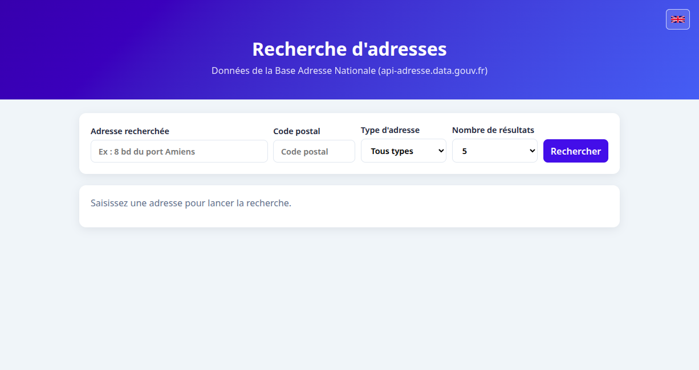

# Recherche d'adresses

Application web JEE (Servlet 6 / JSP), sans framework, qui interroge l'API
[Base Adresse Nationale](https://api-adresse.data.gouv.fr/search/) via un formulaire de recherche.



## Fonctionnement

- `SearchServlet` (`/api/search`) adapte la requête HTTP et renvoie le statut et le JSON de l'API.
- `SearchCriteria` valide et normalise les critères de recherche.
- `SearchApiClient` construit la requête destinée à la Base Adresse Nationale, appelle son API et journalise l'adresse recherchée, le statut, la durée et le JSON retourné. Ces journaux contiennent des données d'adresse : limitez leur accès et leur durée de conservation.
- `SearchApiConfiguration` charge l'URL de l'API et les délais réseau, et exige une URL absolue HTTP(S) avec un hôte.
- `SearchRateLimiter` limite les recherches par adresse distante.
- `index.jsp` affiche le formulaire et le sélecteur de langue ; `js/app.js` appelle le servlet et remplit le tableau de résultats.

La page est disponible en français et en anglais. Le bouton-drapeau bascule entre les deux langues. Le choix est transmis aux erreurs du servlet via `lang`; si sa valeur n'est pas `fr` ou `en`, la langue préférée du navigateur est utilisée. Les textes sont dans `src/main/resources/fr/exemple/adresses/messages.properties` et `messages_en.properties`. L'ajout d'une langue nécessite aussi d'étendre le sélecteur de langue de `index.jsp` et la sélection de locale dans `SearchServlet` ; ajouter seulement un bundle ne suffit pas.

Les coordonnées de chaque résultat ouvrent le visualiseur cartes.gouv.fr sur la position correspondante. Ce lien utilise le permalien du site (`c=longitude,latitude`, `z=16`, `permalink=yes`) et ne nécessite pas d'API ni de clé.

La configuration par défaut de l'API est dans `src/main/resources/fr/exemple/adresses/search-api.properties` : URL, délai de connexion et délai de requête, en secondes. L'URL doit être absolue, utiliser HTTP ou HTTPS et contenir un hôte. Chaque valeur peut être surchargée par une propriété JVM (`-Dban.api.url=...`) ou une variable d'environnement (`BAN_API_URL`). Les clés JVM priment sur les variables d'environnement, qui priment sur le fichier. Les autres clés sont `ban.api.connect-timeout-seconds` / `BAN_API_CONNECT_TIMEOUT_SECONDS` et `ban.api.request-timeout-seconds` / `BAN_API_REQUEST_TIMEOUT_SECONDS`.

Avec `scripts/start.sh`, le JSON journalisé est indenté par défaut. Pour le garder compact, démarrez avec `BAN_API_LOG_JSON_PRETTY=false`. La propriété JVM `-Dban.api.log-json-pretty=true` reste prioritaire sur la variable d'environnement. Ce réglage ne modifie pas le JSON renvoyé au navigateur.

Paramètres acceptés par `/api/search` :

| Paramètre      | Description                                            |
| -------------- | ------------------------------------------------------ |
| `q`            | Requise : minimum 3 après trim, maximum 200 avant trim |
| `limit`        | Nombre de résultats : 1 à 50 (5 par défaut)            |
| `postcode`     | Code postal à 5 chiffres                               |
| `type`         | `housenumber`, `street`, `locality` ou `municipality`  |
| `autocomplete` | `0` ou `1`                                             |
| `lang`         | `fr` ou `en` pour les messages d'erreur                |

Les paramètres facultatifs absents ou vides sont ignorés, sauf `limit` qui vaut alors `5`. Une valeur non vide invalide pour `limit`, `postcode`, `type` ou `autocomplete` est refusée avec une erreur `400` localisée, plutôt que d'être silencieusement ignorée. Une valeur `lang` autre que `fr` ou `en` n'est pas rejetée : elle déclenche le repli sur la langue du navigateur.

Codes de retour : `400` si `q`, `limit`, `postcode`, `type` ou `autocomplete` est invalide ; `429` si l'adresse distante dépasse 30 recherches par minute ; `502` si l'API est injoignable ou si l'appel est interrompu ; sinon le code de l'API est relayé. Le limiteur est local au processus et suit au plus 4096 adresses. Derrière un reverse proxy ou avec plusieurs instances, configurez aussi une limite au niveau du proxy : l'application se base sur l'adresse de connexion (`getRemoteAddr`) et n'utilise pas `X-Forwarded-For` fourni par le client.

## Prérequis

- Java 17 ou plus
- Maven 3.9 ou plus
- Accès Internet (appel à l'API adresse)

## Lancer l'application

Le port Jetty est défini dans `.mvn/maven.config` (`JETTY_PORT`, valeur par défaut `8888`). Les scripts le lisent également. Pour le changer durablement, modifiez cette valeur; pour une seule exécution, utilisez `mvn -DJETTY_PORT=8889 jetty:run`. Les scripts `start.sh`, `status.sh` et `open.sh` acceptent aussi une surcharge, par exemple `JETTY_PORT=8889 ./scripts/start.sh`.

Avec les scripts fournis (Jetty 12) :

```bash
chmod +x scripts/*.sh
./scripts/start.sh     # démarre le serveur en arrière-plan (logs : logs/server.log)
./scripts/status.sh    # indique si le serveur répond
./scripts/open.sh      # ouvre http://localhost:8888/adresses/ dans le navigateur
./scripts/stop.sh      # arrête le serveur lancé par scripts/start.sh
```

Si le port configuré est déjà utilisé, `scripts/start.sh` l’indique et ne lance pas Jetty. Si le serveur ne répond pas après le délai de démarrage, le processus est arrêté; les détails figurent dans `logs/server.log`. Le PID du serveur démarré par le script est conservé dans `logs/.server.pid`.

`scripts/start.sh` démarre en mode silencieux par défaut : les messages Maven et Jetty sous le niveau `ERROR` sont masqués, mais les erreurs restent visibles. Les avertissements émis directement par la JVM, comme celui de Guice concernant `sun.misc.Unsafe`, peuvent encore apparaître. Pour réactiver les messages Maven et Jetty, démarrez avec `JETTY_QUIET_LOGS=0 ./scripts/start.sh`.

Ou directement avec Maven : `mvn jetty:run`, puis ouvrir <http://localhost:8888/adresses/> (ou le port configuré). Pour arrêter cette instance lancée au premier plan, utilisez `Ctrl+C` dans son terminal.

Pour un autre serveur (Tomcat 10.1+, ou tout serveur compatible Jakarta EE 10) :

```bash
mvn package
# déployer target/adresses.war
```

## Tests

```bash
mvn test
```

Les tests JUnit 5 simulent l'API avec un serveur HTTP local : aucun appel réseau externe réel. `SearchCriteriaTest` couvre validation et normalisation, `SearchApiClientTest` la construction d'URL, `SearchApiConfigurationTest` le chargement et la validation de la configuration, `SearchRateLimiterTest` la limite par adresse, et `SearchServletTest` le comportement HTTP, le quota, les messages selon la langue et les deux formats de journalisation JSON.

Un test Selenium vérifie également le formulaire, l'accessibilité du statut, le changement de langue, l'affichage des résultats et la priorité de la recherche la plus récente lorsque les réponses arrivent dans le désordre. Il est désactivé par défaut. Pour le lancer, démarrer d'abord Jetty, puis exécuter la commande suivante (Firefox et `xvfb-run` requis) :

```bash
./scripts/start.sh
xvfb-run -a mvn -Dbrowser.tests=true -Dapp.baseUrl=http://localhost:8888/adresses/ test
```

Selenium Manager télécharge geckodriver s'il n'est pas déjà installé. Le test remplace `fetch` dans le navigateur ; il n'appelle pas l'API adresse.

## Structure

```text
src/main/java/fr/exemple/adresses/   servlet, critères, client API, configuration et limiteur
src/main/resources/fr/exemple/adresses/ bundles de messages et configuration API
.mvn/                                configuration Maven, dont le port Jetty
src/main/webapp/                     index.jsp, css/, js/, images/, WEB-INF/
src/test/java/fr/exemple/adresses/   tests unitaires des critères, du client, de la configuration, du limiteur et du servlet
scripts/                             scripts Bash de démarrage, arrêt et contrôle
logs/                                journaux et PID générés à l'exécution (ignorés par Git)
docs/images/                         captures d'écran intégrées à cette documentation
```
